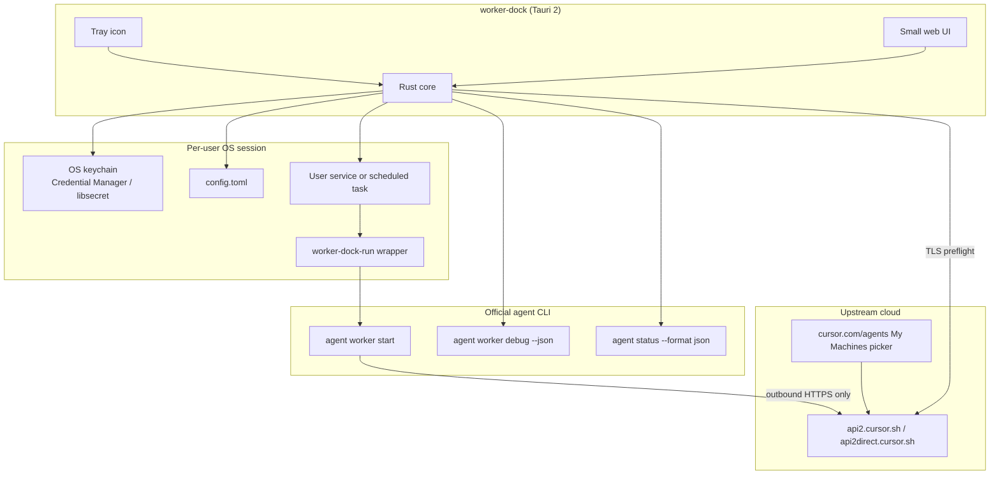
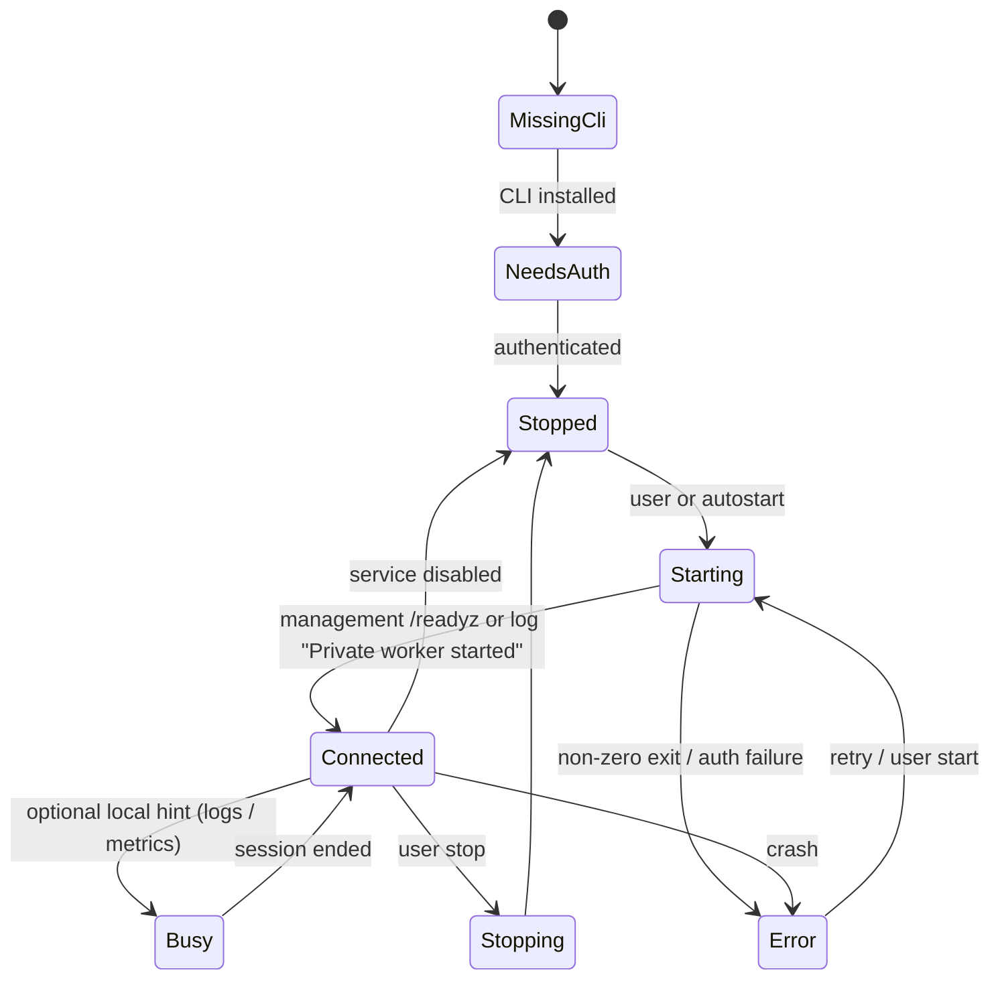
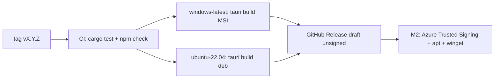

# worker-dock design

**Product:** worker-dock  
**Publisher:** Stand Easy Ops  
**Status:** Implementation started. Scaffold through diagnostics and UI, plus CI that builds unsigned Ubuntu `.deb` and Windows MSI as Actions artifacts on PRs (draft Release still tags only). Signing, apt hosting, and winget publish stay later.  
**Audience:** Developers running personal self-hosted workers on their own Windows or Ubuntu machines.  
**Upstream surface:** the official `agent` CLI (`agent login`, `agent worker start`, `agent worker debug`) and the personal “My Machines” worker model.

worker-dock installs, configures, supervises, and diagnoses those workers. It does **not** reimplement the worker protocol. Branding keeps the word “Cursor” out of the product name, installer name, package identifiers, and UI chrome. Documentation may name the upstream product where accuracy requires it.

Sources (read 2026-10-20):

- [My Machines](https://cursor.com/docs/cloud-agent/self-hosted/my-machines)
- [Self-Hosted Machines](https://cursor.com/docs/cloud-agent/self-hosted)
- [Team Pools / Self-Hosted Pool](https://cursor.com/docs/cloud-agent/self-hosted/pool)
- [Computer use and desktop sharing](https://cursor.com/docs/cloud-agent/self-hosted/computer-use)
- [OIDC identity tokens](https://cursor.com/docs/cloud-agent/identity)
- [Cloud Agents API](https://cursor.com/docs/cloud-agent/api/endpoints)
- [CLI installation](https://cursor.com/docs/cli/installation), [authentication](https://cursor.com/docs/cli/reference/authentication), [configuration](https://cursor.com/docs/cli/reference/configuration), [parameters](https://cursor.com/docs/cli/reference/parameters)
- Live CLI spike: [CLI-SPIKE.md](CLI-SPIKE.md) (`agent` `2026.10.19-6bbf2c4`)
- Stack choice: [TECH-CHOICE.md](TECH-CHOICE.md)

## 1. Goals and non-goals

### Goals

- Let a developer install the official `agent` CLI from the official versioned archive (same files as `https://cursor.com/install`), see its version, keep it pinned, and update only to a vetted build.
- Sign in with browser login (`agent login`) or a **personal** user API key stored in the OS keychain.
- Configure one or more **named** personal workers: repo folders, display name, and documented opt-in flags.
- Run each worker as a **per-user** background job that survives closing the app and (when linger / logon tasks are enabled) reboot, using the signed-in user’s identity.
- Start, stop, and show live logs from a window and a tray icon.
- Run `agent worker debug` and a network preflight against the documented outbound hosts.
- Ship as a signed MSI on winget and a signed `.deb` from an apt repo. macOS (Developer ID + notarisation, later Homebrew cask) is a later milestone.

### Non-goals

- Replacing the official CLI, speaking the worker bridge protocol, or shipping a fork of `agent`.
- Team Pools, `agent worker controller`, Kubernetes spawn hooks, or service-account authentication.
- Running workers as `SYSTEM`, `root`, or another user. Personal workers require a personal credential.
- Using “Cursor” in the product name, window title, installer filename, winget/apt package id, or tray tooltip.
- Managing other people’s machines, org-wide fleets, or dashboard secrets (My Machines workers do not receive dashboard secrets).
- Implementing computer-use helpers, VNC, or `cursor-server`. Those stay inside the official CLI.
- A marketplace, plugin host, or in-app chat with the coding agent.

### Challenges to the tentative direction

The Rust + Tauri 2 direction is accepted (see [TECH-CHOICE.md](TECH-CHOICE.md)). Three product assumptions need to be corrected up front:

1. **Default CLI idle timeout is one hour, not “run forever.”** Live `agent worker --help` defaults `--idle-release-timeout` to `3600` and exits `0` when it fires. Product docs describe My Machines as long-lived. worker-dock must pass `--idle-release-timeout 0` (or `CURSOR_WORKER_IDLE_RELEASE_TIMEOUT=0`) for desktop workers, and must not treat exit `0` as “still healthy.”
2. **The documented workers REST API is not a personal status API.** `GET /v0/private-workers` (and related pool endpoints) authenticate with a **service account** API key; other key types are rejected. A personal API key cannot list “My Machines.” Local process + service state + `agent worker debug --json` are the status sources.
3. **One worker per `--data-dir`.** The CLI takes a data-directory lock (`--wait`). Multiple named workers need isolated data dirs under worker-dock’s prefix. Never let two workers inherit the default `/opt/cursor` (if writable) or `~/.local/share/cursor-agent`.

## 2. User stories

1. **First run:** I install worker-dock. It finds no `agent` on the resolved path, shows the official archive URL, and on click downloads that pinned tarball/zip into the official layout, then shows `agent --version`.
2. **Sign in with browser:** I click Sign in. The app runs `NO_OPEN_BROWSER=1 agent login`, opens the printed URL in my browser, and polls `agent status --format json` until `isAuthenticated` is true.
3. **Sign in with API key:** I paste a personal user API key. It is stored only in the OS keychain. The service wrapper injects `CURSOR_API_KEY` at start. The key never appears in `config.toml`, unit files, or process arguments.
4. **Define a worker:** I name the machine (`--name`), add one or more existing repo folders (`--worker-dir`, first is assignment identity), and leave pool flags off.
5. **Run in the background:** I click Start / Enable on login. A systemd user unit or a per-user scheduled task starts `agent worker … start` as me. Closing worker-dock does not stop the worker.
6. **Survive reboot:** After reboot, the unit/task starts again without opening the UI (Linux linger or Windows logon task).
7. **Watch logs:** The Logs screen tails the supervised process and the CLI session log directory.
8. **Fix “machine missing”:** I run Preflight. The app hits the required hosts over TLS and runs `agent worker debug --json`, then explains auth, repo remotes, and visibility in plain language.
9. **Update:** The app tells me when worker-dock has a new release, and when a **vetted** official CLI is newer than the install. Official latest that is not in our pin list is shown but not applied. I can update each independently.
10. **Tray:** From the tray I start/stop the service or the child worker, open the window, or quit the UI (an installed service keeps running; a child worker stops).

## 3. Architecture



### Process roles

| Process | Lifetime | Privilege | Responsibility |
| --- | --- | --- | --- |
| worker-dock UI | While the window/tray is open | Same as the user | Edit config, drive services, show logs, run debug/preflight |
| OS user service / task | Until the user disables it | Same as the user | Keep one `agent worker` child alive |
| `worker-dock-run` wrapper | Child of the service | Same as the user | Resolve `agent`, inject env from keychain, set `--data-dir`, exec the CLI |
| `agent worker start` | Child of the wrapper | Same as the user | Outbound bridge, tool execution, optional computer-use / live workspace |

The UI is not in the worker’s restart path. Killing the tray must not stop supervised workers.

### Command construction (personal workers only)

Worker flags go **before** `start`. The wrapper always sets an explicit data dir and disables idle release:

```text
agent worker
  --name "<display-name>"
  --worker-dir "<abs-path>" …
  --data-dir "<worker-dock data dir>"
  --idle-release-timeout 0
  --management-addr "127.0.0.1:<port>"
  [--computer-use] [--display :0]
  [--connect-workspace]
  [--identity-socket]
  [--share-desktop view|view_and_control]
  start --verbose
```

Auth is **environment or CLI login**, never `--api-key` on the argv (process listings). Optional `--auth-token-file` is reserved for short-lived tokens and is not the desktop default.

`worker_get` / `worker_save` return this same argv as `startArgv` plus a quoted `commandLine` for the Home preview. The supervisor execs `startArgv` tokens, not the display string. Do not emit `agent worker start --name …`.

`--pool`, `--mint-github-token`, `--clone-git-repos`, `--sync-dashboard-secrets`, and `agent worker controller` are out of scope.

## 4. Process and service model per OS

### Shared rules

- One OS job per named worker. One `--data-dir` per worker (`~/.local/share/worker-dock/workers/<id>/` or `%LOCALAPPDATA%\StandEasyOps\WorkerDock\workers\<id>\`).
- Restart policy: restart on crash; do **not** treat a clean idle-release exit as success we ignore — we pass timeout `0` so that path should not fire.
- PATH: do not assume `~/.local/bin` is visible to GUI/service context. Store the resolved `agent` path after install, and re-resolve on CLI update (symlink under `~/.local/bin/agent` is the Linux source of truth).
- Working directory: the first worker-dir, or the data dir if none yet.
- Logs: wrapper stdout/stderr to a rotating file under the worker data dir **and** to the OS journal / task history.

### Ubuntu (systemd user)

Unit: `~/.config/systemd/user/worker-dock@<id>.service`

```ini
[Unit]
Description=worker-dock personal worker %i
After=network-online.target
Wants=network-online.target

[Service]
Type=simple
ExecStart=/absolute/path/to/worker-dock-run --supervised-run %i
Restart=on-failure
RestartSec=5
NoNewPrivileges=yes
RestrictRealtime=yes
RestrictSUIDSGID=yes
LockPersonality=yes
RestrictAddressFamilies=AF_UNIX AF_INET AF_INET6
SystemCallArchitectures=native
# User-unit only: do not set CapabilityBoundingSet=/AmbientCapabilities=
# (status 218), ProtectSystem=strict (blocks $HOME workspaces), or PrivateTmp
# (hides /tmp/cursor-agent-logs-* from the UI).
# Do not put CURSOR_API_KEY here. The wrapper reads the keychain.

[Install]
WantedBy=default.target
```

- Enable linger so the user unit starts at boot without an interactive login: `loginctl enable-linger $USER` (requires the user’s consent; the app explains why).
- Control plane: `systemctl --user start|stop|enable|disable --now worker-dock@<id>.service` and `systemctl --user show`.
- Logs: `journalctl --user -u worker-dock@<id>.service -f` plus the wrapper log file.
- Computer use on a logged-in desktop should inherit `DISPLAY` / `WAYLAND_DISPLAY` / `XAUTHORITY` from the user session (`systemctl --user` already runs in the session when linger is combined with a graphical login). Headless machines need `--computer-use` without `--display` so the CLI can start a managed TigerVNC desktop (extra apt packages; not installed by worker-dock in MVP).

### Windows (per-user scheduled task)

A classic Windows Service running as `SYSTEM` is **wrong**: My Machines needs a personal credential, and computer-use needs the interactive desktop. MVP uses **Task Scheduler** registered for the current user:

- Name: `StandEasyOps\WorkerDock\<id>`
- Principal: the installing user, **highest privileges only if we later need them** (default: least privilege).
- Triggers: at user logon; optionally at startup if we can safely wait for the user profile (logon is the default).
- Action: `worker-dock-run.exe <id>` with working directory set.
- Settings: restart on failure (e.g. 3 times, 1 minute), do not stop when the user logs out **only if** the task is “run whether user is logged on or not” — that path breaks computer-use. Default: run only when the user is logged on, so the interactive session exists.
- Git for Windows + Git Bash is a hard CLI requirement. worker-dock detects `bash.exe` from Git and fails the preflight with the same message the CLI writes to `%LOCALAPPDATA%\cursor-agent\worker-startup.log`.

A later option is a per-user service (WinSW or a thin Rust service) still running as the user. This start/stop PR uses Task Scheduler (interactive token, least privilege, logon trigger). WinSW is not used.

### macOS (later)

`launchd` agent `~/Library/LaunchAgents/ops.standeasy.worker-dock.<id>.plist`, `KeepAlive`, `RunAtLoad`. Not in MVP.

## 5. Auth and secret storage

### Allowed credentials (My Machines)

| Method | How | Store | Use when |
| --- | --- | --- | --- |
| Browser login | `NO_OPEN_BROWSER=1 agent login`, open URL, poll `agent status --format json` | Official CLI store (see below) | Default on a laptop |
| Personal user API key | User pastes key once | OS keychain only | Devboxes, no browser, or automation |
| User-scoped token | `POST /v1/sub-tokens` | Do not implement | Requires a **team service account** to mint; not a personal-app flow |

Rejected: team Admin keys, organization keys, service-account keys (those start **pool** workers only).

### Where the official CLI already stores login

Observed and documented (do not invent a second copy of browser tokens):

- Linux default file store: `~/.config/cursor/auth.json` (mode `0600` when the CLI writes it). `XDG_CONFIG_HOME` applies.
- Windows: `%APPDATA%\Cursor\auth.json` (third-party research; confirm on a Windows spike before coding).
- macOS: login keychain services `cursor-access-token`, `cursor-refresh-token`, `cursor-api-key` (account `cursor-user`), or `~/.cursor/auth.json` if `AGENT_CLI_CREDENTIAL_STORE=file`.
- `agent logout` clears that store. worker-dock must call it on “Sign out” and also delete our keychain item.

worker-dock **does not** write into the official `auth.json`. If the user chose “personal API key,” we keep that key in **our** keychain entry and pass `CURSOR_API_KEY` into the wrapper environment only.

### worker-dock keychain entries

| Platform | Backend | Service | Account |
| --- | --- | --- | --- |
| Windows | Credential Manager (generic) | `ops.standeasy.worker-dock` | `personal-api-key` |
| Ubuntu | libsecret / Secret Service | `ops.standeasy.worker-dock` | `personal-api-key` |
| macOS later | Keychain | `ops.standeasy.worker-dock` | `personal-api-key` |

Rust crate: `keyring`. Never log the secret. Never put it on argv (`--api-key` is accepted by the CLI and would leak in Task Manager / `ps`).

### Login UX details

- Browser flow: parse the `https://cursor.com/loginDeepControl?...` line from `agent login` stdout (spike: printed when `NO_OPEN_BROWSER=1`). Show “Waiting for browser…” and a Cancel that kills the login process.
- Status JSON (unauthenticated, spike): `{ "status": "unauthenticated", "isAuthenticated": false, "hasAccessToken": false, "hasRefreshToken": false, "message": "Not logged in" }`. Poll until `isAuthenticated` is true.
- `agent about --format json` exposes `userEmail` after login; use it in the UI account chip.
- Short-lived `--auth-token` is documented and accepted by the binary but **omitted** from `agent worker --help`. The CLI warns it cannot refresh. Do not use it for long-lived desktop workers.

### Implementation notes (sign-in PR)

- Commands: `auth_status`, `auth_start_browser_login`, `auth_cancel_browser_login`, `auth_save_api_key`, `auth_sign_out`.
- Browser flow matches the spike: `NO_OPEN_BROWSER=1` plus `--disable-auto-update`, parse stdout for `https://cursor.com/loginDeepControl`, require `redirectTarget=cli`, refuse other hosts/schemes/userinfo/ports, then `open` that URL only. Cancel kills the login process. Poll `agent status --format json` until `isAuthenticated` is true (15 minute cap).
- If the OS cannot open a browser (`xdg-open` / Windows start), the UI still shows the allowlisted URL so the user can copy it.
- Personal API key: `keyring` 4 (`v1` API). Service `ops.standeasy.worker-dock`, account `personal-api-key`. Never logged, never `--api-key` on argv. Injected as `CURSOR_API_KEY` only when `[auth].method = "api_key"`. Other `agent` spawns remove that env var so a leftover shell key cannot override CLI-file login.
- Team / org / service-account keys are rejected conceptually. There is no reliable format detector; worker-dock does not call pool APIs.
- Sign out runs `agent logout` (when the CLI is present) and deletes the keychain item. worker-dock still does **not** write official `auth.json`.
- Linux keychain needs an unlocked Secret Service (GNOME Keyring / libsecret). Windows uses Credential Manager. This cloud VM may have neither; browser login still works without our keychain entry. Confirm Windows `%APPDATA%\Cursor\auth.json` on a Windows spike (still unconfirmed).

## 6. Config file format and location

Human-edited TOML, no secrets.

| Platform | Path |
| --- | --- |
| Linux | `$XDG_CONFIG_HOME/worker-dock/config.toml` (default `~/.config/worker-dock/config.toml`) |
| Windows | `%APPDATA%\StandEasyOps\WorkerDock\config.toml` |
| macOS later | `~/Library/Application Support/worker-dock/config.toml` |

State and logs (not config):

| Platform | Path |
| --- | --- |
| Linux | `$XDG_STATE_HOME/worker-dock/` and `$XDG_CACHE_HOME/worker-dock/` |
| Windows | `%LOCALAPPDATA%\StandEasyOps\WorkerDock\` |

Schema (v1):

```toml
schema_version = 1

[app]
start_minimized = true
check_app_updates = true
check_cli_updates = true

[cli]
# Absolute path to the official binary after install/resolve.
# Linux official layout: ~/.local/bin/agent -> ~/.local/share/cursor-agent/versions/<ver>/cursor-agent
path = ""
install_method = "official_archive"  # official_archive | official_script | manual
pinned_version = "2026.10.19-6bbf2c4"
disable_auto_update = true

[auth]
# How workers authenticate. Secrets are not stored here.
method = "cli_login"               # cli_login | api_key

[[workers]]
id = "8f3c2a10-2b1e-4d3a-9c0a-1b2c3d4e5f60"  # stable UUID, used in unit/task names
name = "dev-laptop"
enabled = true
autostart = true
worker_dirs = ["/home/dev/src/app", "/home/dev/src/infra"]
computer_use = false
display = ""                       # Linux only, e.g. ":0"
connect_workspace = false          # Linux only
identity_socket = false
share_desktop = false
share_desktop_mode = "view"        # view | view_and_control
management_port = 18741            # 127.0.0.1 only
idle_release_timeout = 0
```

Rules:

- `id` never changes after create (service name stability).
- `name` is `--name` and should be unique on the account (routing uses name + git remotes).
- Each `worker_dirs` entry must exist and be a directory before start (CLI requirement; max 20).
- `connect_workspace` is ignored (and warned) on Windows.
- `computer_use` on Windows is warned as unsupported by current CLI docs (Linux + macOS only).
- Unknown future keys are preserved on rewrite.

### Implementation notes (one-worker config PR)

- This build edits **one** `[[workers]]` entry (the first). Extra tables in the file are preserved and not shown, except a count. Multiple named workers stay M2.
- The UI saves display `name` and `worker_dirs` only. On first create, DESIGN defaults are written (`enabled`/`autostart` true, advanced flags off, `management_port = 18741`, `idle_release_timeout = 0`). Later saves do not clobber hand-edited advanced keys.
- `id` is a UUID generated on first save and then never changed. A missing or invalid id is replaced once so the data-dir path cannot leave the workers root.
- Folders must be existing absolute directories (max 20). The first is assignment identity. Native Browse uses `rfd`; paste-an-absolute-path still works if the dialog is unavailable.
- Isolated `--data-dir` is computed and created on Start: Linux `$XDG_DATA_HOME/worker-dock/workers/<id>/` (default `~/.local/share/worker-dock/workers/<id>/`); Windows `%LOCALAPPDATA%\StandEasyOps\WorkerDock\workers\<id>\`. That matches section 4 (data), not `$XDG_STATE_HOME`.
- No `--pool`, `--mint-github-token`, `--clone-git-repos`, `--sync-dashboard-secrets`, or `worker controller` keys are written.

### Implementation notes (start/stop PR)

- The supervisor is the same `worker-dock` binary installed as `worker-dock-run` (`~/.local/bin/worker-dock-run` or `%LOCALAPPDATA%\StandEasyOps\WorkerDock\bin\worker-dock-run.exe`). It enters wrapper mode via `--supervised-run <id>` or when the executable name is `worker-dock-run`.
- Linux unit: `~/.config/systemd/user/worker-dock@.service` started as `worker-dock@<uuid>.service`. Control plane is `systemctl --user`. Linger is opt-in (`loginctl enable-linger`), never enabled silently.
- Windows: Task Scheduler XML imported with `schtasks` (`StandEasyOps\WorkerDock\<id>`), `InteractiveToken`, least privilege, logon trigger, restart 3× / 1 minute. Not SYSTEM. Git Bash is checked at Start (not a full Preflight screen).
- Closing the UI does not stop the job. Stop = `systemctl --user stop` / `schtasks /End`. There is still no `agent worker stop`.
- `CURSOR_API_KEY` is injected by the wrapper from the keychain only when `[auth].method = "api_key"`. It is never in the unit file, task XML, or argv.
- `--disable-auto-update` is the first CLI argument. `--management-addr` is `127.0.0.1:<port>` only. `--computer-use` / `--display` / `--connect-workspace` are omitted on Windows.
- Runtime chips are `stopped` / `starting` / `running` / `failed` from the OS job. `/readyz` and live logs landed in the next PR. Wrapper stdout/stderr append to `<data-dir>/wrapper.log` (rotated at 5 MB).

### Implementation notes (status and live logs PR)

- Lifecycle chips are DESIGN `Stopped` / `Starting` / `Connected` / `Error`. The OS job is still shown as a separate fact (`stopped` / `starting` / `running` / `failed` / `unknown`).
- **Connected** = the job is up **and** (`GET http://127.0.0.1:<port>/readyz` returns 2xx **or** `wrapper.log` contains `Private worker started`). Stale ready lines after Stop are ignored.
- **Starting** = the job is up and `/readyz` is not OK yet. **Error** = the supervisor reported a failed job. **Stopped** includes “supervisor query unknown.”
- Probes are status, not preflight: HTTP only, `127.0.0.1` only, paths `/readyz`, `/healthz`, and `/metrics` only, ~800 ms timeout, no proxy, no redirects. `GET /v0/private-workers` is never called. `/metrics` is parsed for the documented gauges `cursor_self_hosted_worker_connected`, `cursor_self_hosted_worker_session_active`, and `cursor_self_hosted_worker_last_activity_unix_seconds` (live / idle / agent-running). `agent worker debug --json` and outbound TLS preflight landed in the next PR.
- Logs screen: `logs_read` / `logs_open_folder`. Tail last 64 KB / 1000 lines of `<data-dir>/wrapper.log`. On Linux, also `/tmp/cursor-agent-logs-<uid>/latest.log` when present (`Uid:` from `/proc/self/status`; symlink targets must stay under that prefix). Windows CLI session path is still unconfirmed; wrapper.log is the primary tail. Documented `%LOCALAPPDATA%\cursor-agent\worker-startup.log` is shown on Windows if it exists.
- UI polls status ~2 s and logs ~1 s. Pause, copy, and open-folder use the existing `open` crate on the worker data dir. No stderr/stdout filter split. The OS journal (`journalctl --user -u worker-dock@<id>.service`) is not tailed in the app.

## 7. Worker lifecycle and state model



| State | Meaning | How we know |
| --- | --- | --- |
| `MissingCli` | No usable `agent` binary | Path missing or `--version` fails |
| `NeedsAuth` | CLI present, not signed in and no keychain key | `agent status --format json` + keychain |
| `Stopped` | Config exists, service not running | systemd inactive / task not running |
| `Starting` | Service started, bridge not ready | Process up, `/readyz` not OK |
| `Connected` | Worker process running and ready | `/readyz` 200 or parsed ready log line |
| `Busy` | An agent session is active on this worker | Documented `/metrics` gauge `cursor_self_hosted_worker_session_active=1`, else recent wrapper.log claim |
| `Error` | Auth/network/git/config failure | Exit code, log error, debug JSON |
| `Stopping` | Stop requested | Transient |

**Do not** call `GET /v0/private-workers` with a personal key. Documented workers/pool APIs reject non-service-account keys. “Does the picker see me?” is `agent worker debug --json` (`visibilityProbe`) after auth.

`--management-addr 127.0.0.1:<port>` is the liveness bind. Ports are allocated per worker and stored in config. An in-app watchdog restarts a user-started worker (direct or service) with backoff if the process exits or localhost `/readyz` and `/metrics` stay down after a 20s start grace. systemd `Restart=on-failure` still covers a service crash after the UI is closed. Stop / Quit UI / uninstall clear the intent. “Reset worker identity” stops the worker, wipes only the isolated `--data-dir` (where the official CLI stores the logical worker id), and starts again with the same `--name` / `--worker-dir`. There is no `agent worker reset`. “Copy diagnostics” exports redacted logs plus the live probe snapshot.

Stop = stop the user unit/task (SIGTERM to the CLI). There is no `agent worker stop` subcommand (spike).

## 8. UI screens

Keep chrome branded **worker-dock / Stand Easy Ops**. Refer to “the official agent CLI” and “personal workers,” not a trademarked product name.

The shipped UI is **one Home screen plus Settings**, with Logs and Checks in a side drawer. Identifier `ops.standeasy.worker-dock`. Bundle targets are Debian `.deb` and WiX MSI — not macOS.

Branding: teal `#0F4C5C`, ink `#12171F`, paper white; `#2A9D8F` is a focus accent only. Headings use Bricolage Grotesque. The product name is **worker-dock** (window title, header, tray tooltip, About, Linux `.desktop` Name, Windows Start menu, and Add/Remove Programs). Logo is the Stand Easy Ops A1 Wide Stance mark and A7 tile (white mark on the teal header; teal tile for app icons; white mark plus a status dot in the tray). User-facing “Cursor” words are “Connect to Cursor”, “works with the official Cursor CLI”, and the **Cursor Docs** button. **standeasyops.com** sits next to Cursor Docs and opens `https://standeasyops.com`.

| Screen | Purpose |
| --- | --- |
| **Home** | Worker **name** (`--name`) and **repo folders** first, then **Run without service** and **Service setup**. Name row: **Open in Agents** (`https://cursor.com/agents`, or `https://cursor.com/agents/<bcId>` when the worker is busy with a current claim) and **Local status** (`http://127.0.0.1:<port>/readyz`). **Recent agents** under the name card lists the last 5 `bcId`s (newest first) from `Worker claimed by background composer` lines in `wrapper.log`. Status lamp plus **Cursor Docs** and **standeasyops.com**. Read-only command line, Connect to Cursor / sign out. |
| **Settings** | Official CLI install/update, config and data paths, disabled M2 telemetry toggle (not built). |
| **Logs drawer** | Compact tail, pause, copy, open folder. |
| **Checks drawer** | “Run checks”: outbound HTTPS preflight + `agent worker debug --json`. |
| **Tray** | Same Ready / Starting… / Not ready lamp. Open, Start/Stop service, Start/Stop worker (without service), Quit UI. Closing the window hides it; a service keeps running. Quit UI stops a child worker and exits (expected). On Linux AppIndicator, left click opens the menu only — do not toggle the window (a click handler that shows/hides double-fires with the menu and GNOME `CloseRequested`). Open does `unminimize` + `show` + `set_focus` and does not hide. One process, one icon (`tauri-plugin-single-instance`; no second `TrayIconBuilder`). The `.deb` desktop file sets `X-GNOME-AutoRestart=false` so quitting the UI does not make the session relaunch it. Worker autostart stays the systemd user unit. |

### Status lamp

RustDesk-style. Auto-start (`autostartEnabled`) is a separate field and never decides the colour.

Backend `headline`: `ready` | `not_ready` | `starting` | `stopping`. `runMode` is `service` | `direct` | `none`.

| Color | Headline | Meaning |
| --- | --- | --- |
| Green | **Ready** | Worker is **running** (service or child process) |
| Amber | **Starting…** / **Stopping…** | Transient only |
| Red | **Not ready** | Not running — one-line reason underneath (CLI missing, not signed in, not running, or error) |

### Command line (Home)

`worker_get` / `worker_save` expose `startArgv` and `commandLine`. That is the argv the wrapper execs. Worker flags (`--name`, each `--worker-dir`) sit **before** `start`. The UI never shows `agent worker start --name …`. No `--pool` / `--api-key`. Changing name or folders while the job is up prompts a restart so the supervisor rebuilds argv from config.

### Service controls

- Commands: `worker_install`, `worker_uninstall`, `worker_start`, `worker_stop`, `worker_restart`, `worker_set_autostart`, `worker_enable_linger`.
- Status: `installed` / `enabled` / `state` / `canStart` / `canStop` / `canRestart` / `runMode`. Changing name or folders while the job is up sets `restartRequired` from the last applied `startArgv`.
- **Start automatically at login** is its own pill + toggle. It does not turn Ready into amber. Ubuntu enables the user unit **and** linger. Windows is logon-only (interactive token; not boot without a session).
- Start / Stop / Restart buttons follow `canStart` / `canStop` / `canRestart`. Uninstall stops, disables, and removes the unit/task.
- Closing the app does not stop an installed service.

### Run without a service

- Commands: `worker_start_direct`, `worker_stop_direct`, `worker_restart_direct`.
- Spawns the official CLI as a **child of worker-dock** with the same `startArgv` (`--name` and every `--worker-dir` before `start`). No systemd unit or scheduled task.
- **Quit UI** (or process exit) stops the child. Closing the window to the tray does not.
- Service mode and direct mode cannot run at the same time: `canStart` / `canStartDirect` disable the idle side while the other is up.

MVP ships Home (one worker), Settings, Logs, Checks, Tray. Advanced flags stay off unless `config.toml` is edited by hand.

## 9. Update strategy

Two independent updaters. Never update the CLI by overwriting files inside `~/.local/share/cursor-agent` ourselves.

### worker-dock (the app)

- Versioned GitHub Releases. This slice uploads **unsigned** tester `.deb` / MSI to a **draft** prerelease. Signed artifacts wait for Azure Trusted Signing.
- Tauri updater plugin is **not** enabled (ed25519 signature required; cannot be disabled). CI still writes a placeholder `latest.json` with empty signatures and `https://get.standeasyops.com` URLs so the shape exists.
- Windows: WiX MSI (Product/Upgrade identity comes from `ops.standeasy.worker-dock`). In-place signed upgrades are M2.
- Ubuntu: unsigned `.deb` from CI. `apt upgrade` from a signed repo is M2.
- Placeholder public host: `https://get.standeasyops.com` (downloads) and `https://get.standeasyops.com/apt` (later). Not provisioned in this repository.

### Official CLI

- Detect: resolved path (config, official layout, then `PATH`), then `agent --disable-auto-update --version` and `agent --disable-auto-update about --format json`.
- **Pin:** `VETTED_VERSIONS` in Rust, currently `2026.10.19-6bbf2c4` (spike + live install script on 2026-10-20). The UI installs that archive, not “whatever the install script now points at.”
- **Install:** HTTPS GET of the same official package the installers use:
  - Linux: `https://downloads.cursor.com/lab/<ver>/linux/{x64,arm64}/agent-cli-package.tar.gz` → `~/.local/share/cursor-agent/versions/<ver>/` + `~/.local/bin/agent` symlink
  - Windows: `https://downloads.cursor.com/lab/<ver>/windows/{x64,arm64}/agent-cli-package.zip` → `%LOCALAPPDATA%\cursor-agent\versions\<ver>\` + `agent.exe` shims
- worker-dock does **not** pipe `curl | bash` / `irm | iex`. Those scripts are fetched only to read the current official version string. Show the archive URL and require a click.
- Each vetted archive has a pinned SHA-256 in `ARCHIVE_SHA256`. The downloader hashes the stream and refuses to extract on mismatch. Bump the digest when adding a version.
- **Auto-update:** disabled. Every worker-dock spawn of `agent` passes `--disable-auto-update` (changelog-documented; hidden from `--help` on the spike build). We do not run `agent update` except as an implementation detail of a vetted UI action.
- **Update action:** enabled only when the installed build is not the newest vetted version. If the official latest is newer and unvetted, the UI says so and does not install it.
- After install/update, re-resolve the binary and store `cli.path`. Do not assume `~/.local/bin` is on GUI `PATH`.
- Bump the pin by appending to `VETTED_VERSIONS` after a compatibility check (`--version`, `about --format json`, later `status` / `worker debug --json`).

## 10. Packaging and distribution

### Identity (no trademarked words)

| Item | Value |
| --- | --- |
| Product name | worker-dock |
| Publisher | Stand Easy Ops |
| winget id | `StandEasyOps.WorkerDock` |
| Debian package | `worker-dock` |
| Windows ProductName | worker-dock |
| Linux desktop name | worker-dock |
| Reverse-DNS / bundle id later | `ops.standeasy.worker-dock` |

### Windows

- Artifact: WiX MSI from Tauri 2, built on `windows-latest` (WiX does not run on Linux). Per-machine (`ALLUSERS=1`). `bundle.windows.wix.upgradeCode` is pinned so upgrades share one UpgradeCode; WiX issues a new ProductCode per build. Silent: `msiexec /qn /norestart`.
- WebView2: `embedBootstrapper` (~1.8 MB) so winget validation is not a naked network fetch. Depend on `Microsoft.EdgeWebView2Runtime` in the winget manifest when useful.
- Code signing: **Azure Trusted Signing** (Artifact Signing). Service principal with “Trusted Signing Certificate Profile Signer.” `AzureSignTool` or SignTool + dlib. Timestamp: `http://timestamp.acs.microsoft.com/`. Certificates last three days; timestamping is mandatory.
- Sign the embedded exe **and** the final MSI (Tauri `signCommand` during bundle).
- Publish: GitHub Release asset + PR to [microsoft/winget-pkgs](https://github.com/microsoft/winget-pkgs) (`manifests/s/StandEasyOps/WorkerDock/<version>/`). Fields: `InstallerUrl` (HTTPS to our release, not a GitHub vanity that 403s Microsoft’s crawler), `InstallerSha256`, `InstallerType: wix`, publisher/package strings above.
- SmartScreen reputation takes real-world install volume; expect warnings on the first public builds even when signed.

### Ubuntu

- Artifact: Tauri `.deb` with `libwebkit2gtk-4.1-0` and `libgtk-3-0` (plus ayatana/appindicator if tray needs it).
- Build on Ubuntu 22.04 runners (glibc baseline). Also produce `amd64`; `arm64` when we have demand.
- Repo (M2): signed apt repo on object storage + a public HTTPS hostname. Placeholder: `https://get.standeasyops.com/apt`.
  - Layout: `dists/<codename>/main/binary-amd64/`, `pool/main/w/worker-dock/`.
  - Sign `Release` with a Stand Easy Ops apt signing key (GPG) stored in GitHub + a hardware/offline backup.
  - Users later: `deb [signed-by=/usr/share/keyrings/worker-dock.gpg] https://get.standeasyops.com/apt ubuntu jammy main`
  - This slice does **not** create the apt repo, buy DNS, or sign packages.
- Do **not** ship the official `agent` CLI inside the `.deb`. We invoke the official installer so updates and licensing stay upstream.

### macOS (later)

- `.dmg` + Developer ID Application, notarytool, staple.
- Homebrew cask pointing at the signed `.dmg`.
- Apple Team account is an owner action, not an MVP blocker.

### GitHub Actions release pipeline

Trigger: tag `vX.Y.Z`.



### Implementation notes (CI packaging PR)

- Workflows: `.github/workflows/ci.yml` (pull_request + reusable), `.github/workflows/packaging.yml` (pull_request / non-tag push / `workflow_dispatch`: unsigned `.deb` on `ubuntu-22.04` + `ubuntu-24.04` and WiX MSI on `windows-latest`, Actions artifacts only), and `.github/workflows/release.yml` (tag `v*` + `workflow_dispatch`: same bundles, then a draft GitHub Release on tags). Actions are pinned to full SHAs.
- Tests must pass before bundles: Linux `cargo test` + `npm run check` / `build`; Windows `cargo test`. CI also runs `cargo audit`, `npm audit --audit-level=high`, and gitleaks.
- Bundles are **unsigned**. `SIGNING_ENABLED` stays `false`. AzureSignTool / GPG steps are comments in the workflow and [`packaging/README.md`](../packaging/README.md).
- Download/apt URLs live in [`packaging/urls.toml`](../packaging/urls.toml): `https://get.standeasyops.com` and `https://get.standeasyops.com/apt`. Configurable via `DOWNLOAD_BASE_URL` / `APT_BASE_URL`. No DNS or hosting is created here.
- winget id **`StandEasyOps.WorkerDock`** uses a 1.6.0 multi-file tester manifest in `packaging/winget/` (`Scope: machine`, silent `/qn`, pinned WiX `upgradeCode` `{33446F2E-DAB1-5268-912F-3F5D1835AF9C}`). Do not publish to winget-pkgs.
- Packaging CI stamps **`0.1.<github.run_number>`** into `package.json`, `Cargo.toml`, `tauri.conf.json`, and winget `PackageVersion` so each unsigned `.deb` / MSI upgrades the previous install. The version is `major.minor.build` with each field ≤ 65535. Artifact names include that version (`worker-dock_0.1.N_ubuntu-24.04_amd64.deb`, `worker-dock_0.1.N_x64_en-US.msi`). Settings → About and the tray tooltip show it. The committed baseline stays `0.1.0`.
- `latest.json` is written as a release asset with empty signatures. Do not hook the Tauri updater until signing exists.
- Official `agent` CLI is never packaged inside the `.deb` or MSI.
- If GitHub retires `ubuntu-22.04` runners, switch the Linux jobs to `ubuntu-24.04` and note the glibc bump.

Secrets (GitHub Environment `release`, unused until signing): Azure tenant/client/secret, Trusted Signing account/profile/endpoint, apt signing key, Tauri updater private key, Apple certs later. The Trusted Signing cert never lands on the runner disk.

## 11. Security considerations

- **Supervisor, not sandbox.** A connected personal worker executes tool calls as the logged-in user: files, terminal, optional desktop control, optional live workspace (Linux) as that OS user. The UI must say this before the first start.
- **Outbound only.** No inbound ports. Preflight is client TLS to known hosts. `--management-addr` binds `127.0.0.1` only.
- **Secrets.** API keys in the OS keychain. Never in git, config, systemd `Environment=`, or Task Scheduler “arguments.” Wrapper reads keychain at start.
- **File permissions.** `config.toml`, worker data dirs, and `wrapper.log` are created user-only (`0600` / `0700` on Linux; current-user ACL via `icacls` on Windows).
- **Logs.** The supervisor copies official CLI stdout/stderr through a redactor before writing `wrapper.log`. The UI tail is redacted again. Do not print `CURSOR_API_KEY`, `Authorization` headers, or `auth.json` bodies.
- **CLI integrity.** Official archives are HTTPS-only and SHA-256 pinned per version/os/arch.
- **Command injection.** Worker dirs and names are data, not shell. `ExecStart` is argv via the wrapper, not `sh -c`.
- **Install script.** Official `curl | bash` / `irm | iex` is what upstream documents. Show the URL (`https://cursor.com/install`) and require an explicit click. Pinning the script body is a later hardening option.
- **CLI auto-update.** Official CLI auto-update is untrusted input. worker-dock disables it (`--disable-auto-update`) and only applies vetted pins from the UI. Stop workers before a prompted update once services exist.
- **Live workspace.** Linux `--connect-workspace` gives anyone who can open the agent a terminal as the worker OS user (including teammates if VM sharing is on). Default **off**. Explain before enable.
- **Computer use / share-desktop.** Default **off**. Sharing the real desktop (macOS share-desktop) is a later-mac concern; Linux share-desktop uses an isolated desktop. Clipboard stays blocked on share-desktop per upstream.
- **Identity socket.** Default **off**. Any process as the user can mint OIDC tokens for the claimed run.
- **Artifact hosts.** Blocking both S3 artifact buckets disables uploads only; the session continues. Document this on the Preflight screen.
- **Trademark / impersonation.** Package ids and publisher names are Stand Easy Ops. UI does not use upstream marks or logos.
- **Supply chain.** Pin GitHub Actions SHAs, verify MSI/deb signatures in the updater, HTTPS-only artifact URLs.
- **Privacy.** Worker-dock sends no telemetry in MVP. M2 may add **opt-in** app/worker health and crash reports to Stand Easy Ops’ own backend only (see §13). The official CLI may still write session logs under `/tmp/cursor-agent-logs-<uid>`.

### Required outbound hosts (preflight)

From My Machines / Self-Hosted docs:

| Host | Why |
| --- | --- |
| `api2.cursor.sh` | Agent session / default CLI endpoint |
| `api2direct.cursor.sh` | Bridge / privacy routing (seen in worker verbose logs) |
| `downloads.cursor.com` | CLI packages and macOS computer-use helper |
| `agent-stores.s3.us-east-1.amazonaws.com` | Artifact upload |
| `cloud-agent-artifacts.s3.us-east-1.amazonaws.com` | Artifact fallback |
| `cursor.blob.core.windows.net` | Live workspace server download (`--connect-workspace` only) |
| `cursor.com` | Browser login (`loginDeepControl`) and install script |

Preflight: DNS, TCP 443 (skipped when a proxy env var is set), then HTTPS GET. Report DNS/TLS/connect failures. HTTP 403/404 still counts as reachable. Do not treat a blocked artifact host as “worker cannot start.” Honor `HTTPS_PROXY` / `https_proxy` / `HTTP_PROXY` / `http_proxy` (the URL is never shown). Corporate MITM: document `NODE_EXTRA_CA_CERTS` and `network.useHttp1ForAgent` for the **CLI**. worker-dock preflight uses the same **rustls** stack as CLI archive downloads, not the OS trust store.

### Implementation notes (diagnostics PR)

- Commands: `diag_run`. One Preflight button runs the host table and then `agent worker debug --json`.
- Allowlisted hosts only, `https://<host>/` with no userinfo, port, path, or query. Required: `api2.cursor.sh`, `api2direct.cursor.sh`, `downloads.cursor.com`, `cursor.com`. Artifact (warning only): the two S3 buckets. Optional: `cursor.blob.core.windows.net`.
- Debug argv: `--disable-auto-update worker --name … --worker-dir … debug --json`. Same name and folders as the saved worker. Never `--pool` or `--api-key`. `CURSOR_API_KEY` is injected only when `[auth].method = "api_key"`. Output is redacted. Schema is treated as unstable; known fields (`auth.method`, `worker.workerId`, `visibilityProbe`, `computerUse`, `desktopShare`, `warnings`) are shown when present.
- Unauthenticated debug still runs so the UI can show the CLI’s text error. Debug is skipped if the CLI or worker name/folders are missing.
- Windows Git Bash is a required Preflight check. Linux has no Git Bash row.
- CI packaging (`.deb` / MSI workflows) landed in the next PR.

## 12. Risks

| # | Risk | Severity | Mitigation |
| --- | --- | --- | --- |
| 1 | Official CLI flags, defaults, and help drift (already: docs say idle default `0`, live CLI default `3600`; `--auth-token` documented but missing from worker help) | High | Pin a compatibility matrix; gold-file `agent worker --help`; never parse English help as API |
| 2 | No `worker status` / `worker list` / `worker stop`; REST list is service-account-only | High | Local supervisor + localhost `/healthz` `/readyz`; debug JSON for visibility |
| 3 | A new official `2026.x` build breaks start/debug JSON | High | Pin + disable auto-update; smoke-test before adding a version to `VETTED_VERSIONS` |
| 4 | Windows Git Bash + user-session vs Task Scheduler “run whether logged on” | High | Preflight Git Bash; default to interactive-user tasks |
| 5 | Azure Trusted Signing + winget review + SmartScreen delay a real Windows launch | Medium | Sideload signed MSI for early testers; start the winget PR as soon as v1 ships |
| 6 | Linux WebKitGTK / tray / PATH-in-GUI | Medium | Ubuntu 22.04+24.04 test matrix; resolve `agent` ourselves |
| 7 | Linger / logon-task consent and “worker ran while I was away” surprise | Medium | Explicit enable copy; easy disable |
| 8 | Keychain vs systemd user / cron-like tasks that cannot unlock libsecret | Medium | Prefer CLI login file store for headless; document unlocking the session keyring |
| 9 | Default `--data-dir` colliding with `/opt/cursor` on some machines | Medium | Always pass our own `--data-dir` |
| 10 | Trademark complaints if UI or winget text is sloppy | Medium | Review all user-visible strings; legal pass before winget |
| 11 | Computer-use extra packages (ffmpeg, xdotool, TigerVNC, Xfce) | Low for MVP | Detect via debug JSON; do not auto-apt in MVP |
| 12 | Official install script is `curl \| bash` | Low | Explicit consent; show URL |

## 13. Phased milestone plan

### MVP (Windows + Ubuntu, one happy path)

- Tauri 2 skeleton, tray, First run, Sign in, Home (at least one worker), Logs, Preflight, Settings.
- Official CLI detect / pinned archive install / `--disable-auto-update` / vetted update action.
- Browser login + personal API key (keychain).
- Generate systemd user unit **or** per-user scheduled task with wrapper, `--idle-release-timeout 0`, isolated `--data-dir`, localhost `--management-addr`.
- Start/stop/autostart, live logs.
- Network preflight + `agent worker debug --json`.
- Unsigned tester MSI/deb from GitHub Actions (tag `vX.Y.Z` → draft Release). Public winget/apt and Azure Trusted Signing slip to M2; hooks and placeholder URLs (`get.standeasyops.com`) are in `packaging/`.

Out of MVP: multiple concurrent workers can be in the data model but only one enabled worker needs to be polished; computer-use and live workspace toggles can be hidden behind “Advanced.”

### M2 — Multi-worker, public channels, and health telemetry

- Multiple named workers, isolated data dirs, unique management ports.
- Advanced flags: `--computer-use`, `--connect-workspace` (Linux), `--identity-socket`, `--share-desktop`.
- Git Bash and Linux desktop-package checks in Preflight.
- Signed MSI + winget-pkgs PR; signed apt repo on R2.
- Tauri updater hooked to GitHub Releases.
- **Opt-in app and worker health telemetry, plus crash reporting, to Stand Easy Ops’ own backend.** Default off. Not the official CLI. No product analytics in MVP. Settings already shows a disabled toggle labeled as not built; do not implement the pipe in this slice.

### M3 — macOS and polish

- `.dmg`, Developer ID, notarisation, Homebrew cask.
- launchd agent.
- Richer debug JSON rendering; optional “open official agents page.”
- CLI compatibility matrix in-repo; gold-file help snapshots in CI.

### Later / out of scope unless the owner expands the product

- Team Pools, controller, service accounts, pending-request API.
- Replacing the official CLI.
- In-app coding agent.

## 14. Open questions for the owner

1. One polished worker is enough for this slice. Several named workers are M2.
2. Should computer-use and live workspace appear in MVP (Linux), or stay Advanced/M2?
3. winget id is `StandEasyOps.WorkerDock` (documented, not published). Public download/apt host placeholder is `get.standeasyops.com` (not provisioned). Confirm before buying DNS.
4. Will Stand Easy Ops obtain Azure Trusted Signing and an Apple Developer ID before M2/M3, or do we sideload until then?
5. Should worker-dock **ever** grow Team Pool / service-account support, or is that a different product?
6. Default CLI auto-update: **Disable.** worker-dock always invokes `agent` with `--disable-auto-update` and only applies a vetted pin from the UI.
7. Windows supervision in this slice: **Task Scheduler** (interactive user). WinSW was not needed.
8. UI implementation inside Tauri: **Svelte** (SvelteKit + `@sveltejs/adapter-static` in SPA mode, official `create-tauri-app` `svelte-ts` template). Vanilla TypeScript was the original TECH-CHOICE.md recommendation; the owner chose Svelte for the scaffold.
9. Placeholder host is `https://get.standeasyops.com`. A winget crawler-reachable hostname is still required before publishing; do not use a GitHub vanity that 403s.
10. Legal: approved wording for “official agent CLI / personal workers” in the UI and winget `ShortDescription`?
